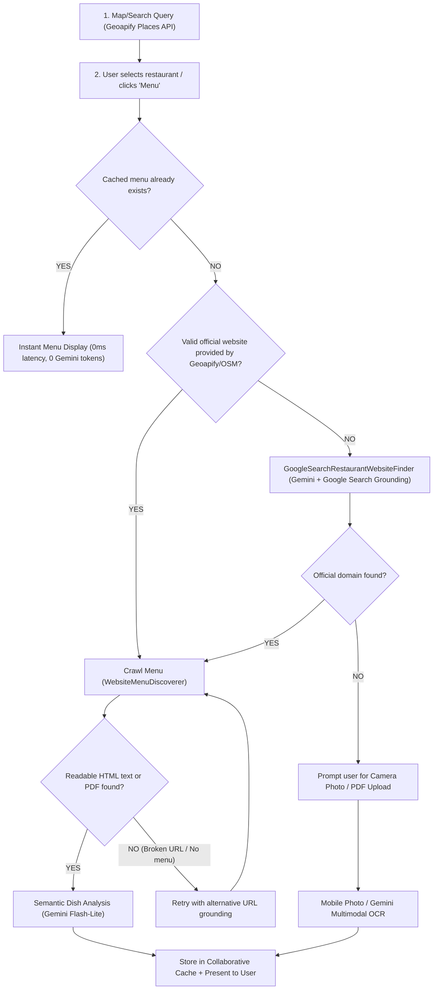

# Vegan Tools — Architecture & Engineering Guide

This document provides a comprehensive technical overview of the **Vegan Tools** platform architecture, data flows, restaurant discovery lifecycle, and deployment infrastructure.

---

## 🏗️ 1. High-Level System Architecture

Vegan Tools is built as a TypeScript monorepo with high separation of concerns:

```text
vegan-tools/
├── apps/
│   ├── api/          # Node.js + Fastify backend server
│   │                 # - Geoapify & OpenStreetMap place search
│   │                 # - Gemini 3.0 / 3.1 Flash-Lite extraction & OCR
│   │                 # - Google Search Grounding for official website resolution
│   │                 # - Deterministic HTML/PDF web crawler with SSRF protection
│   │                 # - Supabase PostgreSQL + Storage persistence
│   └── web/          # React 19 + Vite + plain CSS frontend
│                     # - Leaflet interactive map with custom clustering & anchor pins
│                     # - Basemap chain: CARTO Voyager, Geoapify, OpenFreeMap (light/dark)
│                     # - PWA service worker with offline precaching
│                     # - Bilingual i18n (Catalan & English)
│                     # - Adaptive 420ms search debouncing & bottom sheet UX
├── packages/
│   └── domain/       # Pure domain logic & shared Zod schemas
│                     # - Ingredient dictionary & deterministic rule engine
│                     # - Restaurant candidate & menu data structures
│                     # - Review scoring & aggregate stats schemas
└── supabase/         # PostgreSQL schema migrations & storage bucket definitions
```

---

## 🧭 2. Restaurant Search & Menu Discovery Lifecycle

The core value proposition of Vegan Tools is providing **verified, auditable menu sources** directly from the restaurant's primary website or physical menu, rather than relying on stale third-party reviews.

### End-to-End Discovery Pipeline



### Detailed Pipeline Stages

#### Stage 1: Location & Place Search (`GET /v1/restaurants/search`)
1. **Debounced Querying**: The frontend debounces user input by **420 ms** before dispatching a search request.
2. **Primary Provider (Geoapify Places API v2)**:
   - Queries `https://api.geoapify.com/v2/places` with categories `catering.restaurant`, `catering.cafe`, `catering.fast_food`, `catering.bakery`, `catering.ice_cream`.
   - Filters by circular coordinates (`circle:lon,lat,radius`) with proximity bias.
   - Extracts structured diet tags (`diet.vegan`, `diet.vegetarian`) and official contact URLs.
3. **Transparent Fallback (OpenStreetMap + Curated List)**:
   - If `GEOAPIFY_API_KEY` is not present or rate-limited, queries the curated in-memory catalog, Komoot Photon, and Overpass spatial APIs.

#### Stage 2: Official Website Resolution (`POST /v1/restaurants/resolve`)
1. **Cache Verification (`RestaurantMenuCache`)**: Checks if the restaurant menu was already analyzed by any user. If found, returns immediately.
2. **Website Validation**: If a valid official website URL is already attached, it proceeds to crawling.
3. **AI Grounding (`GoogleSearchRestaurantWebsiteFinder`)**:
   - If the website is missing or comes from an aggregator (e.g. TripAdvisor, TheFork, Glovo, Instagram), the backend invokes **Gemini Flash-Lite with real-time Google Search Grounding** (`tools: [{ googleSearch: {} }]`).
   - Filters out third-party directories and extracts only the restaurant's own official domain or direct menu page.

#### Stage 3: Deterministic Crawling (`WebsiteMenuDiscoverer`)
1. Fetches the homepage and extracts navigation links matching menu keywords (`/carta`, `/menu`, `/plats`, `/food`, `/dishes`, `.pdf`).
2. Follows links up to depth 2, downloads HTML/PDF, strips headers/footers/cookies, and scores visible text.
3. Enforces strict **SSRF protection** against private subnets (`127.0.0.1`, `10.0.0.0/8`, `192.168.0.0/16`, AWS metadata `169.254.169.254`).

#### Stage 4: Semantic Analysis & Collaborative Caching (`MenuAnalyzer`)
1. The extracted clean text or PDF/image is sent to **Gemini Flash-Lite** with vegan classification rules.
2. Dishes are categorized into `VEGAN`, `VEGETARIAN`, `NOT_VEGAN`, or `ADAPTABLE` (suggested plant-based modifications to request from restaurant staff, not a commercial guarantee).
3. Results are saved to **Supabase** / shared cache so subsequent users receive instant results.

#### Fallback: Physical Menu / Blackboard OCR
- When a restaurant has zero digital presence, users can snap a photo with their phone. Gemini multimodal OCR processes the photo in ~1.5 seconds and saves it for the community.

---

## 🔒 3. Security & Privacy Architecture

- **Zero-Tracking & GDPR Compliance**: User GPS coordinates and search queries are processed ephemerally in-memory and never stored in user profiles or sold to advertisers.
- **SSRF (Server-Side Request Forgery) Defense**: The web crawler strictly blocks private IP ranges, local loopbacks, and non-HTTP protocols.
- **Storage Lifecycle**: User-uploaded raw menu originals in Supabase Storage are automatically marked with an expiration retention policy.

### Basemap (Map Tiles)

- **Preference (Nils)**: CARTO Voyager first, then Geoapify OSM Bright Smooth, then OpenFreeMap. The app tries them in that order and moves to the next one if a source fails. Implemented in `apps/web/src/utils/basemap.ts`.
- **Chain** (the first working source wins):
  1. **CARTO Voyager** (raster, `basemaps.cartocdn.com`; `dark_all` in dark mode). Needs `VITE_CARTO_API_KEY`: CARTO now requires a free key for raster tiles.
  2. **Geoapify OSM Bright Smooth** (raster, `maps.geoapify.com`). Needs `VITE_GEOAPIFY_API_KEY` (free plan: 3,000 credits/day).
  3. **OpenFreeMap** vector tiles (`tiles.openfreemap.org`, `positron` / `dark`): no key, no usage limits. Drawn by MapLibre GL inside Leaflet's tile pane via `@maplibre/maplibre-gl-leaflet`, `import()`ed on map mount into the `vendor-maplibre` chunk. Needs WebGL.
  4. **OSM raster** `tile.openstreetmap.org` (CSS-inverted in dark mode). Last resort only, never the default, to keep within the OSM tile usage policy.
- **Automatic fallback**: a raster source is abandoned after 6 tile errors before any tile loads (missing key, invalid key, quota, blocked network). A vector source is abandoned if MapLibre fails to load. Keyed sources without a key are skipped.
- **Keys in the browser**: `VITE_*` values are compiled into the public bundle. Restrict each key to our domain (HTTP referrer) in the provider's dashboard. Without keys the map uses OpenFreeMap, so the app still works.
- **Planned, not implemented**: Protomaps (self-hosted PMTiles via `@protomaps/leaflet`) as a further option. The public planet file is about 120 GB and the hosted API needs a key, so it needs a decision on where the file lives first.
- **Attribution**: "© OpenFreeMap © OpenMapTiles © OpenStreetMap" (or the equivalent credit of the active source), without the "Leaflet" prefix.
- **Offline**: Workbox caches styles/TileJSON (`StaleWhileRevalidate`) and versioned tiles, fonts and sprites (`CacheFirst`) in `apps/web/vite.config.ts`.

---

## ⚙️ 4. Environment Variables Reference

| Variable | Purpose | Example |
| :--- | :--- | :--- |
| `GEOAPIFY_API_KEY` | Primary restaurant search and place details | `a1b2c3d4e5f6...` |
| `GEMINI_API_KEY` | Google GenAI API key for OCR, search grounding, and dish classification | `AIzaSy...` |
| `GEMINI_MODEL` | Primary LLM for menu extraction and dish analysis | `gemini-3.1-flash-lite` / `gemini-2.5-flash` |
| `GEMINI_WEBSITE_MODEL` | Model for official website search grounding | `gemini-3.1-flash-lite` |
| `DEFAULT_RESTAURANT_NEAR` | Default city bias when searching without location | `Barcelona` |
| `WEB_ORIGIN` | Allowed CORS origins for API requests | `https://vegantools.org,http://localhost:5173` |
| `VITE_API_URL` | API base URL for the frontend bundle | `https://api.vegantools.org` |
| `SUPABASE_URL` | Supabase PostgreSQL project URL | `https://xyzcompany.supabase.co` |
| `SUPABASE_SECRET_KEY` | Supabase server secret key (`service_role`) | `sb_secret_...` |
| `MENU_SOURCE_DIR` | Local disk fallback for menu uploads when Supabase is disabled | `./data/menu-sources` |

---

## 📡 5. API Endpoints Reference

### Restaurants & Discovery
- `GET /health` — Health check endpoint (`200 OK`).
- `GET /v1/location/approximate` — Fast zero-cost IP geolocation via Cloudflare/Render headers.
- `GET /v1/restaurants/curated` — Featured curated restaurants sorted by user distance.
- `GET /v1/restaurants/search` — Search restaurants by name, keywords, radius, and coordinates.
- `POST /v1/restaurants/resolve` — Resolve place identity and verified official website via AI search grounding.

### Menus & OCR
- `POST /v1/menus/discover` — Crawl restaurant website to extract HTML menus or PDF links.
- `POST /v1/menus/analyses` — Start AI extraction of uploaded PDF or image menu files.
- `GET /v1/menus/analyses/:id` — Poll extraction progress and retrieve structured draft.
- `PATCH /v1/menus/analyses/:id` — Edit dish details, names, prices, or dietary verdicts.
- `POST /v1/menus/:id/dishes/:dishId/feedback` — Submit community dish correction with bilingual polishing.
- `POST /v1/menus/:id/notes` — Save restaurant community notes (`communityNotes`, `communityNotesCa`).
- `POST /v1/menus/:id/publish` — Publish menu with a public slug.
- `GET /v1/public/menus/:slug` — Read published menu without requiring edit tokens.
- `GET /v1/menu-sources/:menuId/:storedName` — Stream original uploaded source PDF/image.

### Reviews & Community
- `GET /v1/restaurants/:restaurantId/reviews` — Fetch paginated reviews and leaf score statistics.
- `POST /v1/restaurants/:restaurantId/reviews` — Submit or update an authenticated review (1–5 leaves).
- `DELETE /v1/restaurants/:restaurantId/reviews` — Delete a user's own review.
- `GET /v1/users/me/export` — Everything stored about the signed-in user (reviews, visits, Top 4).
- `DELETE /v1/users/me` — Delete the signed-in user's reviews, visits, Top 4 and Supabase Auth account.
- `GET /v1/users/:userId/visits` — The user's own diary (owner's token required).

### Products & Ingredients
- `GET /v1/products/:gtin` — Product and verdict by barcode: Open Food, Beauty and Products Facts combined; without ingredients, a web search for the published list (accepted only if the cited page contains it), judged by the rule engine (`product-resolver.ts`).
- `POST /v1/products/:gtin/evidence` — Submit user-verified product evidence.
- `POST /v1/ingredients/classify` — Deterministically classify raw ingredient text.
- `POST /v1/ingredients/extract` — OCR ingredient text from a photographed product label.
- `POST /v1/recipes/veganize` — Substitute non-vegan ingredients with plant-based alternatives.
- `POST /v1/scan/photo` — Universal camera: what a photo shows (label, food, cosmetic, clothing, activity, place, menu) and whether it involves animals.
- `POST /v1/scan/url` — What an unknown scanned link is (page downloaded with SSRF protection and classified).
- `GET /v1/brands/cruelty-free?name=` — Whether a cosmetics brand tests on animals, with web sources.

---

## 🎯 6. Reliability, Evidence Hierarchy & Classification Standard

In safety-critical dietary classification, **a false positive is dangerous**. Declaring a non-vegan item as "vegan" violates user trust and ethical boundaries.

### The Strict Precautionary Standard (Conservative Evidence-Based Classification)
- Classification follows a **strict precautionary principle**: when evidence is incomplete or doubtful, verdicts remain conservative.
- Ambiguous ingredients without verifiable provenance are explicitly marked as `PROBABLY_VEGAN` or `UNKNOWN`.
- Absence of a recognized animal ingredient is **never** sufficient on its own to declare an item `VEGAN`.
- Definitive verdicts (`VEGAN` or `NOT_VEGAN`) require verified provenance according to the Evidence Hierarchy below.

### Strict Evidence Hierarchy
When evaluating product packages, barcode registries, and restaurant menus, sources are prioritized in strict descending order:
```text
1. Recognised Third-Party Certification (e.g. V-Label, Vegan Society sunflower)
2. Current Official Manufacturer / Restaurant Statement
3. Packaging Label verified by a Human Reviewer
4. Provenanced Open Database Records (e.g. Open Food Facts)
5. Automated LLM Extraction & Web Search Grounding
```

> [!IMPORTANT]
> Lower layers may suggest candidates and highlight potential contradictions, but they can **never** silently promote themselves above higher assurance tiers.

### Ingredient Classification Rules (`@vegan-tools/domain`)
- **Slaughter & Meat Derivatives**: Any ingredient derived from slaughtered animals (e.g. gelatin, carmine/E120, rennet, animal lard) immediately yields `NOT_VEGAN` and `NON_VEGETARIAN`.
- **Dairy, Eggs & Bee Products**: Ingredients such as whey, casein, albumen, shellac, and honey yield `VEGETARIAN` and `NOT_VEGAN`.
- **Dual-Origin Additives**: Additives that can be synthesized from either animal fats or plant oils (such as Mono- and diglycerides of fatty acids / **E471**, stearic acid, glycerin) default to `PROBABLY_VEGAN` unless plant-origin is explicitly certified on the label.
- **Precautionary Allergen Statements**: Statements such as *"May contain traces of milk or eggs"* describe shared equipment cross-contact rather than intentional recipe ingredients. Under standard vegan guidelines, they do not invalidate an ethical `VEGAN` verdict, but are flagged separately as precautionary trace information (strictly informational; not a clinical guarantee for severe food allergies or coeliac disease).

### Data Lifecycle & Auditability
- **Immutable Product Revisions**: Product modifications create a new historical revision rather than destructively overwriting previous entries.
- **Ephemeral Raw Uploads**: Raw photographed images and PDF uploads are retained temporarily in private storage for extraction and scheduled for deletion after 30 days.
- **Auditable Citations**: Every structured output links back to its verified `sourceUrl`, extraction timestamp, and rule engine version.

---

## 🧪 7. Ingredient Classification (`packages/domain`)

Ingredient lists (barcode products and photographed labels) are classified deterministically, with no network call, by the same code in the API and in the browser:

1. **Hand-written dictionary** (`ingredient-dictionary.ts`): ~30 ingredients with explanations, E-numbers and substitutions.
2. **Open Food Facts animal lexicon** (`animal-lexicon.ts`, generated by `npm run build:lexicon`): ~4,250 animal-derived terms in Catalan, Spanish, English, French, German and Italian. Plant products named after animal ones ("llet de coco", "rice milk") are not flagged.
3. **No match is not proof**: a list with no recognised animal ingredient is `probably_vegan` and never definitive. Only a verified vegan claim yields `vegan`.

`golden-benchmark.test.ts` runs this classifier on 182 hand-written labels and fails CI if an animal product reads as vegan. Measurements: [`docs/benchmark-results.md`](./benchmark-results.md).

---

## ✅ 8. Quality & Speed Standard

What "good enough to ship" means, and which check enforces each part. `npm run check` runs all of it locally; CI runs the same gates.

### Test layers

| Layer | Tool | Catches | Runs in |
| :--- | :--- | :--- | :--- |
| Unit and component | Vitest (+ jsdom) | Logic, rendering, error states of one component | `npm test`, CI `Tests` |
| Golden classification set | Vitest (`golden-benchmark.test.ts`) | Any animal product read as vegan; classifier speed | `npm test` |
| End to end | Playwright (`e2e/`) | Real browser flows on a **desktop** and a **mobile** (Pixel 7, touch) profile, the scanner through a fake camera, speed budgets | `npm run test:e2e`, CI `E2E` |
| Live providers | `npm run smoke:api` | Deployed API and provider keys work | Before a deploy, by hand |
| Real-world scans | `npm run eval:scan`, `npm run eval:menus` | Real barcodes, links and cosmetics brands (`eval/scan-cases.json`); real menus vs look-alikes (`eval/menu-links.json`). Spend Gemini quota | By hand, against an API without Supabase |
| Camera frames | `scripts/bench-barcode-formats.ts`, `scripts/read-frame.ts` | Reader speed per format; why a saved real frame is or is not read | By hand |

Rules:

- **A feature that uses a device API** (camera, geolocation, file pickers) needs an E2E test in both profiles. Mocking the component in a page test is not coverage of that component: the scanner camera broke in October 2026 on every device without a native `BarcodeDetector`, and the only test mocked `BarcodeCamera` away.
- **E2E tests start with the API unreachable** and mock only what they need. Pages must render, and throw no uncaught error, when the API is down or cold.
- **Known gap**: the fake camera exists only in Chromium, so iPhone Safari is covered through the same code path (ZXing-C++ in WebAssembly through the `barcode-detector` ponyfill, which Chromium on Linux and Windows also uses) but not by a real WebKit run.

### Speed targets

Measured on a mid-range phone profile (Pixel 7 with 4x CPU throttling). *Target* is what users should get; *CI ceiling* is the loose limit that fails the build, so a slow CI machine does not make tests flaky.

| Measure | Target | CI ceiling | Nov 2026 |
| :--- | :--- | :--- | :--- |
| Home largest contentful paint | ≤ 2.5 s | 6 s | 3.7 s |
| Map visible (`/map`) | ≤ 3 s | 12 s | 5.2 s |
| Barcode scan to product shown | ≤ 3 s | 15 s | ~2 s |
| API, warm, search and product lookup | ≤ 1 s | — | 0.3–1.0 s |
| Ingredient classification, one label | ≤ 5 ms | 182 labels < 1 s | ~0.9 ms |

JavaScript downloaded per route (gzip) is the hard gate, because it is deterministic and is what makes a phone slow:

| Route | Budget | Nov 2026 |
| :--- | :--- | :--- |
| `/` | 320 kB | 304 kB |
| `/scanner` | 290 kB | 273 kB |
| `/recipes` | 305 kB | 289 kB |
| `/resources` | 290 kB | 200 kB |
| `/map` | 700 kB | 665 kB (MapLibre is ~290 kB of it) |

Raising a budget is allowed, in the same change that needs it, with the reason in the commit message. Measures below target are in the roadmap.

Not covered yet: Render cold starts (about a minute after 15 idle minutes on the free plan) and menu analysis with Gemini, which depends on the restaurant's website and is not run in CI to avoid spending quota.

---

## 🚀 9. Production Deployment

### Frontend (Render Static Site / Cloudflare Pages)
- **Root Directory**: `/`
- **Build Command**: `npm run build -w @vegan-tools/domain && npm run build -w @vegan-tools/web`
- **Publish Directory**: `apps/web/dist`
- **Environment Variables**:
  - `VITE_API_URL=https://vegan-tools-api.onrender.com`
  - `VITE_SUPABASE_URL=https://ictqmbgzaxmixhkazdce.supabase.co`
  - `VITE_SUPABASE_ANON_KEY=<clau anon/publicable de Supabase>`
- **SPA Rewrite**: `/*` → `/index.html`

### Backend (Render Web Service)
- **Runtime**: Node.js (v22+)
- **Build Command**: `npm ci && npm run build -w @vegan-tools/domain && npm run build -w @vegan-tools/api`
- **Start Command**: `npm run start -w @vegan-tools/api`
- **Keep-Alive**: Set up an external uptime ping (e.g. `cron-job.org` or `Better Stack`) to `/health` every 10–14 minutes during active hours to avoid free-tier cold starts.

